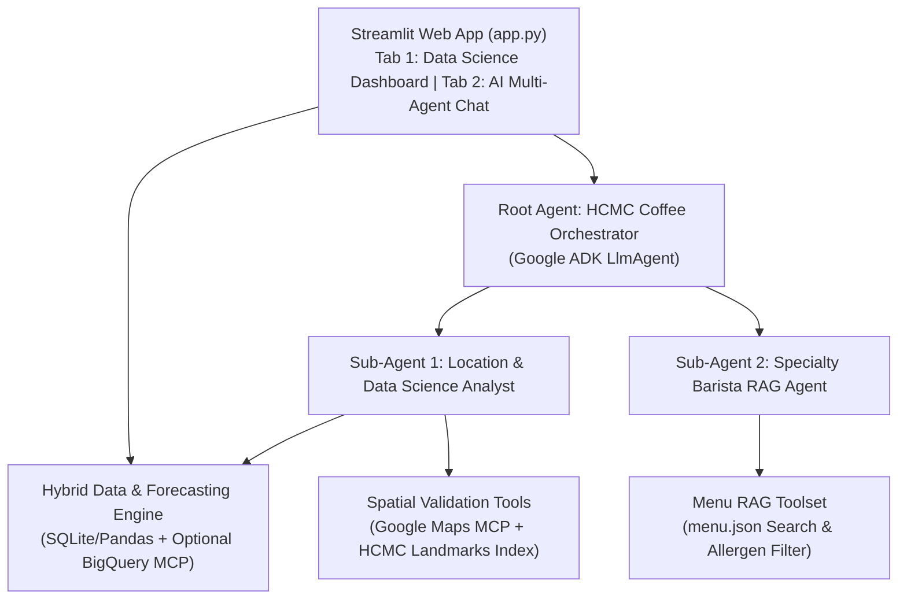

# ☕ HCMC Specialty Coffee: Location Intelligence & AI Barista Agent

Hệ thống **Multi-Agent AI & Applied Data Science** được xây dựng bằng **Google Agent Development Kit (ADK)**, kết hợp **Model Context Protocol (MCP)**, **Phân tích dữ liệu & Dự báo chuỗi thời gian (Time-Series Forecasting)** và **Retrieval-Augmented Generation (RAG)** cho bài toán mở rộng chuỗi Cà phê Đặc sản tại **TP. Hồ Chí Minh**.

---

## 🏗️ Kiến trúc Hệ thống (System Architecture)

---

## 🎯 Hai Bài Toán Cốt Lõi

1. **Location Intelligence & Sales Forecasting (Applied Data Science):**
   - Phân tích nhân khẩu học (`demographics.csv`) và lưu lượng khách bộ hành theo khung giờ Sáng/Chiều/Tối (`foot_traffic.csv`) tại 8 khu vực trọng điểm TP.HCM (Bến Nghé Q1, Tân Định Q1, Võ Văn Tần Q3, Thảo Điền, Phú Mỹ Hưng Q7, Phan Xích Long, Bình Thạnh, Tân Bình).
   - Kiểm tra độ bão hòa đối thủ cạnh tranh và khoảng cách chuỗi cung ứng thực tế qua **Google Maps MCP**.
   - Định giá sản phẩm (`cafe_prices.csv`) và dự báo sản lượng bán & doanh thu tháng tới bằng mô hình hồi quy xu hướng trên dữ liệu lịch sử (`sales_history_weekly.csv`).
2. **AI Barista Customer Experience (RAG & Safety Guardrails):**
   - Tư vấn đồ uống & bánh ngọt dựa chặt chẽ vào thực đơn (`menu.json`).
   - Lọc an toàn tuyệt đối theo chất gây dị ứng (`allergens`: `dairy`, `wheat`, `nuts`) và sở thích (`tags`).

---

## 🗺️ Lộ trình Phát triển (Roadmap)

- [x] **Giai đoạn 1:** Thiết kế Kiến trúc Hệ thống & Khởi tạo Dự án
- [ ] **Giai đoạn 2:** Xây dựng Bộ dữ liệu Thị trường Cà phê TP.HCM & Công cụ SQL + Dự báo Doanh số (`data/`, `src/tools/data_tools.py`)
- [ ] **Giai đoạn 3:** Xây dựng Công cụ RAG Thực đơn & Phân tích Thực địa Google Maps MCP (`src/tools/menu_rag.py`, `src/tools/maps_mcp.py`)
- [ ] **Giai đoạn 4:** Xây dựng Hệ thống Multi-Agent với Google ADK (`src/agents/coffee_agents.py`)
- [ ] **Giai đoạn 5:** Xây dựng Giao diện Streamlit Dashboard + Chat & Đóng gói Docker / Cloud Run (`app.py`, `Dockerfile`)
